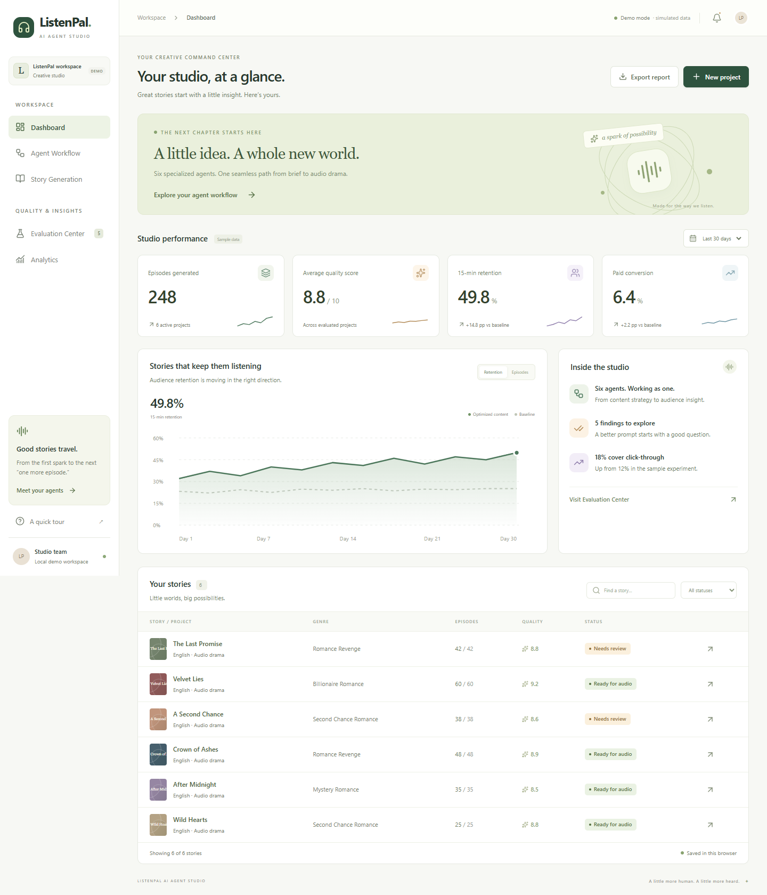

# ListenPal AI Agent Studio

一个可部署到 **GitHub + Vercel** 的 AI 有声剧生产平台 Demo，基于 `docs/product_design.md` 实现。通过六个 Agent 的工作流、质量评测与 Prompt 优化，演示从内容 Brief 到音频生产规划、再到数据反馈的闭环。

默认使用确定性的 Mock 数据，**无需 API Key、数据库或独立后端**。



## 已完成的页面

| 页面 | 路径 | 可操作功能 |
| --- | --- | --- |
| Dashboard | `/` | 剧集数量、平均质量、15 分钟留存、转化；7/30 天切换；项目搜索和状态筛选；创建项目；CSV 导出 |
| Agent Workflow | `/workflow` | 六节点流程图；Input / Output / Evaluation Metric；Prompt 查看；运行、取消、重试；运行记录；JSON 导出 |
| Evaluation Center | `/evaluation` | 剧情、人物、Hook、AI Pattern；Bad Case → 根因 → 可编辑 Prompt → 模拟重新生成与评测；前后证据；状态筛选；报告导出 |
| Story Generation | `/stories` | 用户画像、题材、剧集长度；Story Brief、角色设定、Story Bible 和 Episode Outline |
| Analytics | `/analytics` | CTR、15 分钟留存、付费点留存、付费转化；剧集长度、演播形式、付费卡点三种示例 A/B 对比 |

项目、Prompt 优化和最近 20 次工作流记录保存到浏览器 `localStorage`。刷新后恢复，清除站点数据可重置 Demo。跨设备或不同浏览器的数据互不共享。

## 本地启动

使用 **Node.js 22.12+**，推荐 Node.js 22 LTS。在项目根目录（本 README 所在目录）执行：

```bash
npm ci
npm run dev
```

打开终端显示的地址，默认为 `http://127.0.0.1:5173`。

```bash
npm run check      # 逻辑测试 + TypeScript 检查 + 生产构建
npm run build      # 构建产物：frontend/dist
npm run preview    # 本地预览生产构建
```

浏览器自动化测试：

```bash
npx playwright install chromium
npm run test:e2e
```

可以用 `PLAYWRIGHT_CHROMIUM_EXECUTABLE_PATH` 指定已安装的 Chrome 可执行文件。CI 默认使用 Playwright Chromium。

## GitHub + Vercel 部署

### 1. 上传 GitHub

在 GitHub 创建一个空仓库。在本项目根目录执行，下方地址替换为你自己的仓库：

```bash
git init
git add .
git commit -m "Build ListenPal AI Agent Studio demo"
git branch -M main
git remote add origin https://github.com/YOUR_USERNAME/ListenPal-AI-Agent-Studio.git
git push -u origin main
```

`.gitignore` 已排除依赖、构建产物、环境变量、缓存和测试临时文件。锁文件、源码、截图与文档会进入仓库。

### 2. 导入 Vercel

在 Vercel 选择 **Add New → Project → Import Git Repository**，选择刚上传的仓库。

| 配置 | 值 |
| --- | --- |
| Root Directory | `.`（上传此项目内容作为仓库根目录） |
| Framework Preset | Vite |
| Install Command | `npm ci` |
| Build Command | `npm run build` |
| Output Directory | `frontend/dist` |
| Node.js Version | 22.x |
| Environment Variables | 无需配置 |

如果将整个工作区作为仓库上传，Root Directory 应设为 `ListenPal-AI-Agent-Studio`。不要把 Root Directory 设为 `frontend`，因为 Mock 数据和工作区锁文件位于上一级。

根目录 `vercel.json` 已写入上述构建配置和 SPA 路由回退；部署后直接访问或刷新 `/workflow`、`/evaluation` 等路由会加载应用。后续推送可由 Vercel 的 Git 集成触发部署。参考：[Vercel 官方 Vite 部署文档](https://vercel.com/docs/frameworks/frontend/vite)。

本次交付为可部署源码，尚未上传你的 GitHub 仓库或发布到 Vercel。

## 三分钟演示路线

1. **Dashboard**：介绍生成规模、质量、留存、转化；切换时间范围，搜索一个故事。
2. **New project**：填写标题、用户画像、题材、长度和冲突 Brief。
3. **Run workflow**：观看六个 Agent 顺序执行；点击节点查看输入、输出和评测标准。
4. **Evaluation Center**：选择 `The Last Promise`，打开 `Character drift`，修改并应用 Prompt，点击 `Re-evaluate`，查看 `7.2 → 9.0` 和更新后的文本证据。
5. **Agent Workflow → Story Planning → Prompt**：展示优化后的 v2 指令，说明质量反馈如何回到生产阶段。
6. **Analytics**：介绍剧集长度、演播形式、付费卡点的实验思路，以及数据如何反馈到下一轮内容 Brief。

## 技术与边界

- React 19、TypeScript、Vite 7、Tailwind CSS 4；React Router 管理路由，Lucide 提供图标。
- SVG 趋势图和原创几何封面均为本地资源，部署不依赖外部图片或字体服务。
- 工作流每步有可取消的异步过程；输出、项目进度和评测状态共享同一份应用状态。
- Prompt 优化和评测提升由固定示例驱动。编辑 Prompt 不会调用真实模型，示例文本不代表模型实际生成能力。
- Audio Agent 输出生产计划，**不合成音频**；Analytics 使用示例事件数据，数值不代表真实业务结果或统计显著性。
- 本次以单个 Vercel 静态项目完成 Demo。设计文档中的 FastAPI 可在后续真实模型接入阶段作为服务层引入；当前部署不需要 Render / Railway。

## 项目结构

```text
ListenPal-AI-Agent-Studio/
├── frontend/
│   ├── public/                # 本地图标
│   ├── src/
│   │   ├── components/       # 页面标题、弹窗、图表、指标卡
│   │   ├── lib/              # 数据模型、评测逻辑、共享状态、逻辑测试
│   │   ├── pages/            # 五个产品页面
│   │   ├── App.tsx
│   │   └── styles.css
│   └── vite.config.ts
├── demo-data/studio.json      # 六个故事、五个 Bad Case、三个实验
├── docs/                     # 产品原文、流程、评测、实现映射
├── screenshots/              # 三个核心页及手机截图
├── tests/                    # 浏览器流程测试
├── .github/workflows/ci.yml   # GitHub 自动校验
├── package-lock.json
├── playwright.config.ts
└── vercel.json
```

## 验证

- 8 项逻辑测试：时间范围、组合筛选、Prompt 状态转换、质量闸门、重复评测、评分稳定性、输出长度、CSV 转义。
- 6 项浏览器测试：Dashboard 筛选/导出；创建与完整运行；取消与重试；优化与证据反馈；手机布局和路由；异常存储和 404 恢复。
- `npm run build` 包含严格 TypeScript 检查与生产打包。
- 本地截图： [Workflow](screenshots/workflow.png) · [Evaluation](screenshots/evaluation.png) · [Mobile](screenshots/dashboard-mobile.png)。

## 文档

- [产品设计原文](docs/product_design.md)
- [Agent Workflow](docs/agent_workflow.md)
- [评测与优化闭环](docs/evaluation_system.md)
- [需求实现映射](docs/implementation.md)
